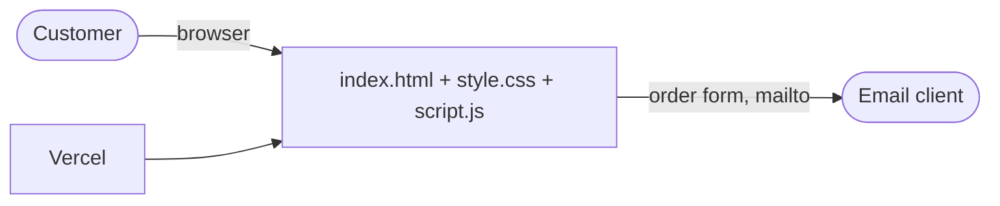
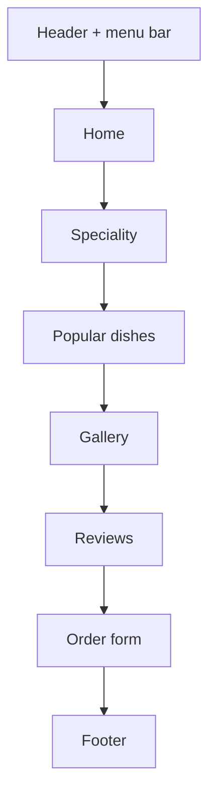

# EazyEatz: High-Level Design

A responsive food-ordering website: browse specialities, popular dishes, gallery and reviews, then place an order through a simple form. Live at [eazy-eatz-pink.vercel.app](https://eazy-eatz-pink.vercel.app). For code-level detail see the [Low-Level Design](lld.md).

## 1. Context

## 2. Page sections

## 3. Tech

| Item | Choice |
|---|---|
| Stack | HTML, CSS, vanilla JavaScript |
| Ordering | Form with `action="mailto:…"` (opens the visitor's email app) |
| Hosting | Vercel |
