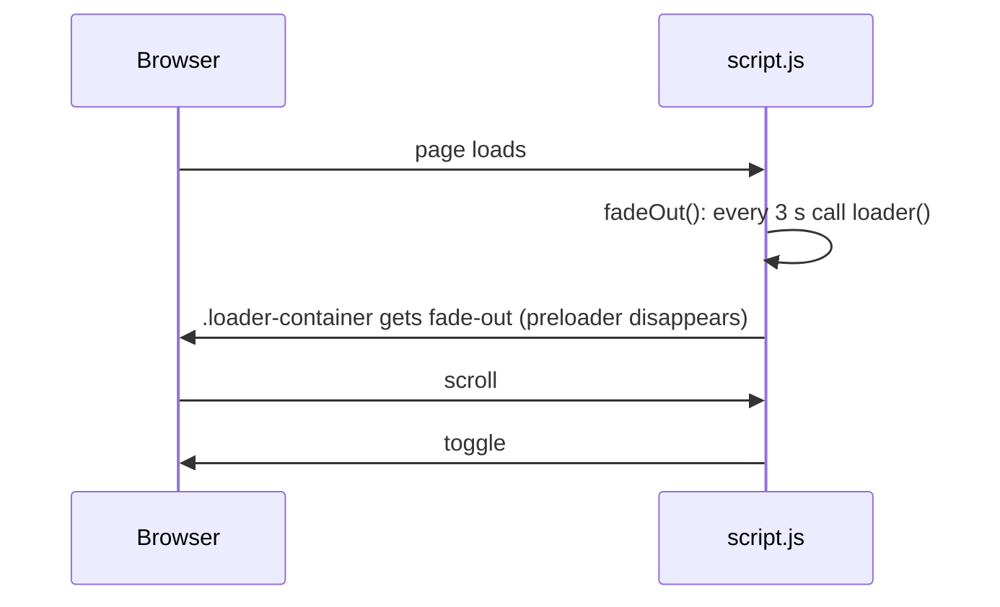

# EazyEatz: Low-Level Design

For the big picture see the [High-Level Design](hld.md).

## 1. Sections

| `id` | Content |
|---|---|
| `home` | Hero and call to action |
| `speciality` | Speciality categories |
| `popular` | Popular dishes as cards (`.box`) |
| `gallery` | Food photos |
| `review` | Customer reviews |
| `order` | Order form: name, e-mail, phone number, food name, address, "order now" |
| `scroll-top` | Back-to-top button |

## 2. Script (`script.js`)

| Code | Behavior |
|---|---|
| `window.onscroll` | Shows `#scroll-top` (adds `active`) after 60 px of scrolling |
| `loader()` | Adds `fade-out` to `.loader-container` |
| `fadeOut()` | Runs `loader` after 3 seconds (`setInterval`) |

## 3. Notes

The order form uses `mailto:`, so it only works for visitors with an email app; a form service (e.g. Web3Forms) or a small backend would make ordering reliable. `window.onload = fadeOut()` calls the function immediately rather than on load; `setTimeout` would also be enough instead of `setInterval`.
